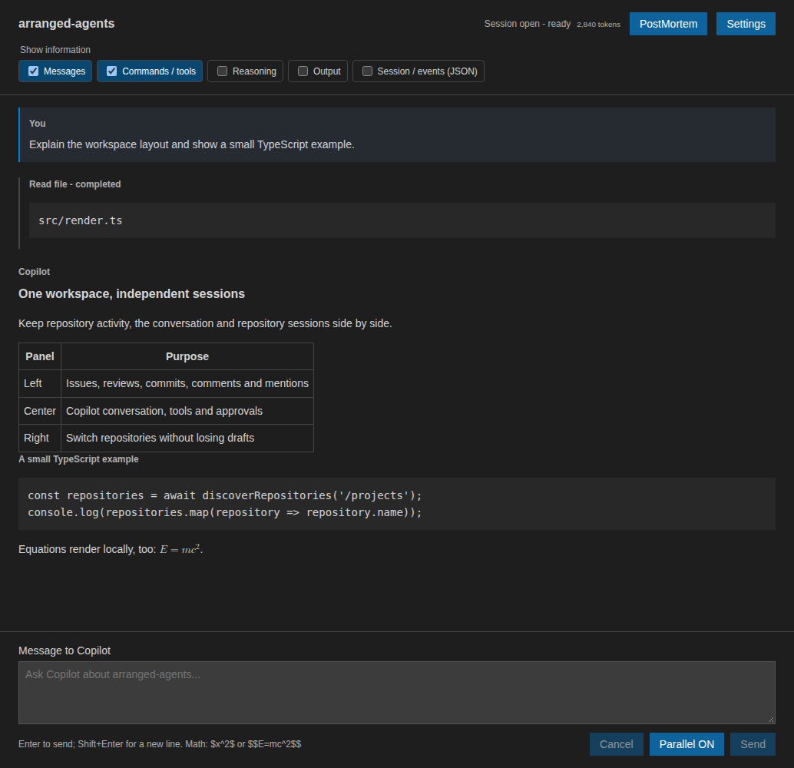

Conversations
=============

Select a repository, wait for **Session open - ready**, then enter a message in
the center panel. Press **Enter** or select **Send** to submit it;
**Shift+Enter** inserts a new line. Messages are limited to 20,000 characters.

Rendering and attachments
-------------------------

Responses render Markdown headings, lists, tables and fenced code. Inline
``$x^2$`` and display ``$$E=mc^2$$`` equations use native MathML without remote
fonts or scripts.

   Rendered conversation with illustrative messages and a completed tool call.

Paste up to five PNG, JPEG, GIF or WebP images into the message box, each no
larger than 5 MiB. Images may be sent without text. Attachment drafts follow their
repository while switching tabs, but unsent images are not restored after the
application restarts. Sent images are retained with the conversation.

Markdown reply images and structured tool-result images are displayed at a
bounded size. HTTPS images load without a referrer. Local files, HTTP image
sources, SVG and HTML images are blocked.

Transcript controls
-------------------

The default transcript displays messages and concise command or tool summaries,
including running, completed and failed status. Errors always remain visible.
The controls above the conversation can additionally show **Reasoning**,
**Output** and **Session / events (JSON)**, or hide messages and command
summaries.

Filters affect presentation only: they do not stop execution, remove history or
hide pending permission and question controls. Technical streaming fragments
are grouped, while raw metadata and timestamps remain available under expandable
event details.

Text can be selected and copied while a response streams. Standard keyboard and
context-menu copy and paste actions work in the transcript, message box and
answer box.

Usage counter
-------------

The small counter beside the session status displays generated output tokens
reported by Copilot, including subagents and parallel requests. It persists with
the conversation and resets for a new session. Older saved conversations without
a count begin at zero; earlier usage is not estimated.

Tools and questions
-------------------

Copilot can inspect and modify the selected repository through its normal tools.
Permission requests appear inline with readable commands, paths and proposed
changes. Copilot questions provide choice buttons and, when supported, a text
answer box. See :doc:`safeguards` for automatic approvals and security
boundaries.
