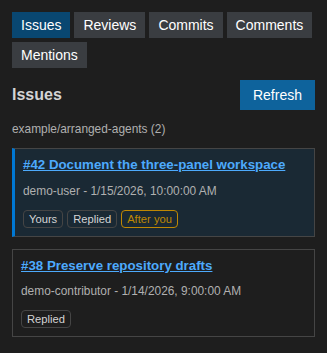

GitHub activity
===============

The left panel follows the selected repository and provides five views:
**Issues**, **Reviews**, **Commits**, **Comments** and **Mentions**. GitHub reads
are independent of Copilot and do not consume model requests.

Issues and reviews
------------------

Issues and pull requests you created have a distinct background and a **Yours**
marker. **Replied** marks discussions in which you commented or submitted a
review. **After you** indicates that another participant responded after your
latest contribution.

   Example issues and participation indicators using demo data.

Comments and mentions
---------------------

**Comments** combines your comments and submitted reviews with later responses,
including closed discussions and inline review replies. Draft reviews are not
included.

**Mentions** finds direct ``@username`` pings in descriptions, comments,
submitted reviews and inline review comments when you have not responded later
in the discussion. It excludes your own pings and team mentions. GitHub search
indexing can delay results, so **Load more** may find older entries even after an
empty page.

Commits
-------

**Commits** displays the latest 30 commits on the current local branch. A commit
opens on GitHub when a GitHub remote is available. Unpushed commits remain in the
list but may not have a corresponding GitHub page.

Fetching and ordering
---------------------

Use **Refresh** to fetch current activity and **Load more** to paginate supported
views. There is no automatic background polling. Lists are newest-first:
issues and reviews use update time, comment groups use their latest displayed
response, and commits use author date.

The panel uses the installed and authenticated ``gh`` CLI. Authentication,
permissions, rate limits and API failures are shown explicitly instead of being
represented as empty results.
