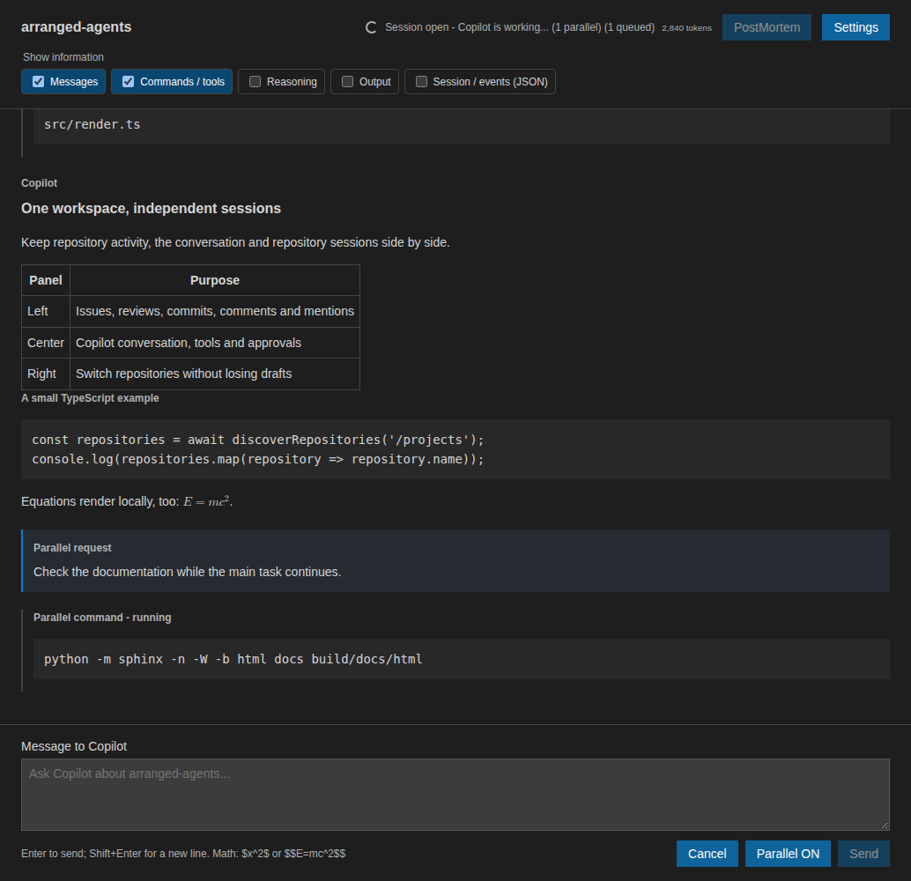

Parallel and queued work
========================

The **Parallel ON/OFF** control beside **Send** determines how messages submitted
while work is already running are handled. It defaults to **ON**.

Parallel requests
-----------------

With Parallel ON, a new request starts immediately in an independent Copilot
session. It receives a bounded snapshot of up to 80,000 characters from the
visible conversation as reference context. Its messages, tools and approvals
carry a **Parallel** label.

   Example running parallel request alongside a main session and queued work.

Parallel agents use the same repository and normal permission controls. They can
run tools and edit files at the same time as the main agent, so changes to the
same files can conflict. Their answers are visible and saved, but are not
automatically injected into the main agent's model history. File changes remain
shared.

Queued requests
---------------

With Parallel OFF, a new message joins a repository-local FIFO queue. The main
session processes queued messages in submission order after its current request
and all parallel requests finish. Changing the toggle affects future submissions
only; when no work is active, either mode uses the main session directly.

Cancellation and lifecycle
--------------------------

**Cancel** stops the main and parallel requests for the selected repository and
discards its queued messages. Closing the session or application, removing the
repository, or starting a new session has the same effect on pending work.
Discarded requests are marked as not sent and are never replayed automatically.

A parallel failure is reported without failing the main request. Parallel
sessions are archived after completion and are included in the repository's
normal session-deletion controls.
