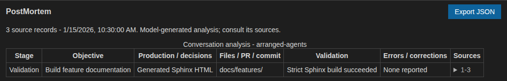

Conversation PostMortem
=======================

After work finishes, select **PostMortem** above the conversation to turn the
current session into an evidence-linked report. The analysis includes the full
recorded conversation, even when transcript filters hide some categories.

Report contents
---------------

The report groups coherent stages such as analysis, implementation, validation
and correction into a table. Each row records:

* the objective;
* production and decisions;
* files, pull requests and commits;
* validations;
* errors and corrections;
* numbered source records.

Expand **Sources** to inspect the requests, answers, commands, results and
technical events behind a row. Failed and abandoned attempts remain part of the
analysis.

   Illustrative report linked to the displayed demo conversation.

The report is a model-generated interpretation, not an independent Git or test
audit. Artifacts and validation can only be reported when the conversation
contains supporting evidence. Analysis uses separate tool-free model requests,
the configured model and the normal Copilot allowance.

Snapshots and updates
---------------------

The analysis uses a stable snapshot after main, parallel and queued work has
finished. Archived conversations and unrelated GitHub activity are excluded.
Continuing the conversation does not mutate an existing report; a notice marks
it as stale until **PostMortem** is run again.

Reports are saved and archived with their conversations. Invalid or incomplete
model output is shown as an error rather than accepted as a partial report.

JSON export
-----------

**Export JSON** saves versioned repository and session metadata, generation
time, a source count and fingerprint, report rows, and the complete analysed
source transcript. Row message ranges identify the inclusive supporting
evidence.

The export can contain sensitive prompts, command output and tool details. Review
it before sharing.
