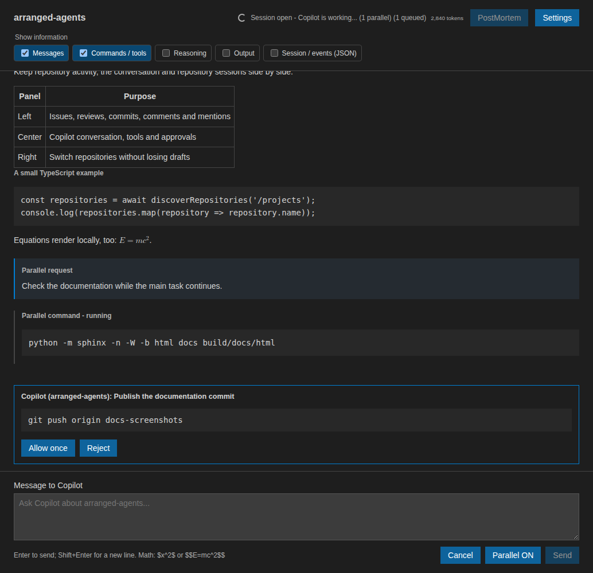

Safeguards and data boundaries
==============================

Repository and model context
----------------------------

No workspace files, editor selections or other repositories are attached
automatically. Each clicked repository is the working directory of its own CLI
client. Configuration discovery, skills, on-demand instructions and host Git
context are enabled, while repository file hooks and cross-session store
integration remain disabled.

The CLI runs locally, but model requests and relevant tool results can be sent
to GitHub Copilot under its normal authentication and service-side data policies.

Tool permissions
----------------

Built-in tools can read and edit files and execute commands. Local file reads,
HTTPS reads from GitHub service domains, read-only GitHub MCP tools, and commands
classified as read-only by the CLI are approved automatically. Literal read-only
Git and GitHub queries, such as ``git diff``, ``git status`` and
``gh issue list/view``, are also allowed even without a read-only classification.

``git fetch`` and ``git worktree list/add/move/remove/prune/repair`` are
automatically approved. Fetch can download objects and update remote-tracking
references; worktree operations can create, move and remove working directories.
Repeated ``-C`` and ``-c`` options can be combined with these commands.
``-c`` settings must belong to the recognized non-executable settings: boolean
advice, quoting, index, filesystem and fetch-pruning settings, color modes,
rename detection and untracked-file display. Disabling a pager or filesystem
monitor, or setting ``core.hooksPath=/dev/null`` to disable hooks, is also allowed.
Unknown settings and options that execute a custom program require confirmation.

Literal test commands are also approved: ``npm test``, ``npm run test:*``,
``pnpm``/``yarn`` test scripts, ``node --test``, ``pytest``,
``python -m pytest``/``unittest``, ``ctest`` and
``cargo``/``go``/``dotnet``/``mvn``/``gradle``/``make test``.
Test code and scripts can write artifacts and execute project-defined code.
The additional command exceptions do not cover shell expansions or redirections.

Other HTTP or HTTPS reads require consent for the URL origin: scheme, hostname
and port. **Allow <origin> and remember** saves approval across repositories and
sessions. Redirects, subdomains, ports and schemes are separate origins.
Approved origins can be reviewed or removed in the Arranged Agents settings.

Every command in a pipeline or compound command must qualify individually.
Other writes and repository-changing Git or GitHub actions remain manual.
Sandbox escalation, warnings and managed requests that require human approval
always remain manual, including for the commands listed above. Pending requests
identify their repository and stay visible regardless of transcript filters.
Cancellation or closure rejects them.

   Example manual approval for a repository-changing command. No command was
   executed to produce this screenshot.

Webview and content security
----------------------------

The application authorizes only its nonce-protected script. Model HTML and tool
output are escaped, math rendering disables trusted TeX commands, and no remote
scripts or fonts load. Only validated raster attachments and reply images are
displayed. HTTP and HTTPS links open externally through VS Code; executable and
local-file schemes are rejected.

Workspace Trust is required. The CLI executable path is machine-scoped.

Stored data
-----------

Versioned snapshots use atomic, serialized writes in VS Code global storage.
On POSIX systems, the directory is private and files use mode 0600. Snapshots
contain plaintext conversations, tool output, attachments and drafts; they are
not encrypted or synchronized.

Known limitations
-----------------

There are no automatic editor attachments or Marketplace publication. Model
context resumption depends on the CLI's own saved session. A crash can lose
changes since the latest periodic save, although normal closure flushes pending
writes.

The GitHub activity panel is read-only and has no background polling. Its
participation indicators compare timestamps rather than read status, and search
indexing can delay comment and mention results. Local commits without a published
GitHub hash cannot open in the browser.

Automated checks cover rendering, permission controls, persistence and the SDK
subprocess lifecycle. They do not replace interactive extension-host validation
of Workspace Trust, deactivation and visual layout.
