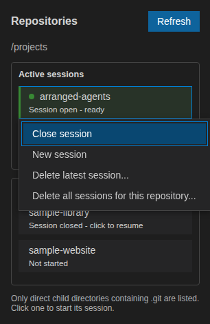

Repository sessions
===================

Every selected repository receives its own Copilot client, session, working
directory, transcript and draft. Switching repositories never merges model
context. Sessions start lazily and other repositories continue independently
while background work runs.

Persistence and resume
----------------------

Closing the application stops its CLI processes and saves conversations, drafts,
the selected repository, token counts and session identifiers. Reopening with
the same parent directory restores the interface without starting Copilot.
Selecting a repository resumes its saved SDK session and model context.

History is stored as private, unencrypted JSON in the extension's VS Code global
storage, outside the repositories. It is not synchronized and should not be used
as a backup. Simultaneous windows for the same parent share one snapshot; the
last saved window takes precedence.

Interrupted operations remain visible but are not sent again after reopening.
Pending commands, questions and permission prompts are not continued. If the
CLI's saved session is unavailable, the failure is shown instead of silently
creating a replacement. **New session** explicitly starts fresh while retaining
the previous transcript on screen as reference; that transcript is not replayed
to the model.

Crash recovery
--------------

If the Copilot process disconnects during startup or a request, Arranged Agents
attempts bounded automatic recovery within the operation timeout. It resumes the
saved SDK session, retains partial output and asks the agent to inspect recorded
results and repository state before continuing.

Recovery is not an exactly-once guarantee: an interrupted external or destructive
action may have an unknown result. Authentication failures, invalid models,
missing saved sessions, timeouts and explicit cancellation are not retried.

Session menu
------------

Right-click a repository, or focus it and press **Shift+F10**, to access:

* **Close session**, which stops Copilot but preserves resumable context;
* **New session**, which archives the current conversation and starts blank;
* **Delete latest session**, which removes the newest conversation and restores
  the previous archive without starting Copilot;
* **Delete all sessions for this repository**, which removes its current and
  archived Arranged Agents conversations.

   Session management menu opened on a demo repository.

Deletion requires inline confirmation. It removes both the application's local
record and the corresponding Copilot session through the SDK. It never deletes
repository files, unrelated Copilot sessions or another repository's history.
Partial failures retain undeleted records and display an error for retry.
