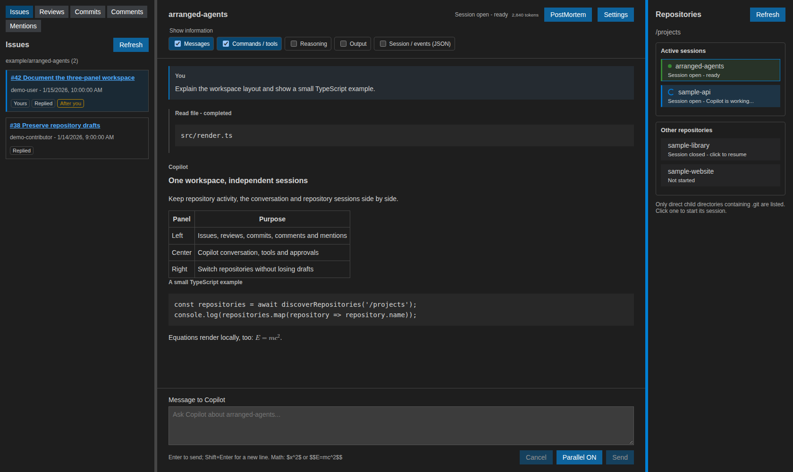

Arranged Agents
===============

Version |release|.

.. image:: ../media/icon.svg
   :alt: Arranged Agents icon
   :width: 128px
   :height: 128px

Arranged Agents is a three-panel application in a VS Code editor tab. The left
panel shows issues, PRs, comments and commits, the center contains a Copilot conversation with HTML and
equations, and the right lists Git repositories directly beneath a chosen parent
directory. A repository's independent session starts only when you click it.
It uses the locally installed GitHub Copilot CLI, your existing login and allowance.

The CLI runs locally, but model requests go to GitHub Copilot. This is not an
offline model, and the extension is not an official GitHub product.

   Repository activity, Markdown conversations and independent sessions in one
   tab. Screenshots use illustrative demo data, not a live Copilot conversation
   or GitHub activity.

.. figure:: images/postmortem.png
   :alt: PostMortem report with validation results, source references and JSON export.

   PostMortem turns a recorded conversation into an evidence-linked report.
   See the :doc:`features` for more screenshots and explanations.

.. toctree::
   :maxdepth: 1

   getting_started
   features
   design
   development
